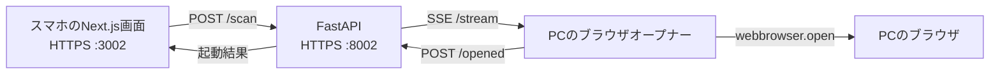

# Sma-Scan 仕様書

Sma-Scanは、スマホやタブレットで読み取ったQRコードのURLを、同じネットワークにあるPCのブラウザで開くツールです。この文書は現行の実装を記述します。利用者は「起動と終了」を、開発者は「画面仕様」と「API仕様」を参照してください。

## QRコードを読むとPCのブラウザでURLを開く



画面は `src/`、APIは `backend/`、PC側のオープナーと起動スクリプトは `scripts/` にあります。Docker Composeが画面とAPIを起動し、オープナーはPC上のPythonプロセスとして動きます。

1. 画面がQRコードを読み取るとカメラを止め、URLを `POST /scan` に送ります。
2. APIはURLを検証し、SSEで接続中のPCオープナーへ渡します。
3. オープナーはPCでブラウザの起動を試み、その結果をAPIへ通知します。
4. APIから応答が返ると、画面に成功またはエラーを表示します。結果通知が15秒以内に届かなければタイムアウトします。

## 画面仕様

| 状態             | 表示と操作                                                                                                                 |
| ---------------- | -------------------------------------------------------------------------------------------------------------------------- |
| 接続コードがない | PCの起動画面に表示されたコードの入力欄と「接続する」ボタンを表示する。                                                     |
| スキャン中       | 背面カメラでQRコードを読み取る。「スキャンを停止」で手動停止できる。                                                       |
| 読み取り後       | 直ちにカメラを止め、PCからの応答を待つ。同じ読み取りによる連続送信はしない。                                               |
| 成功             | 開いたURLと成功メッセージを表示する。「次のQRコードを読み取る」で再開する。                                                |
| 失敗             | エラーを表示し、利用者が「スキャンを開始」を押せる状態にする。認証エラーの場合は保存した接続コードを消し、入力画面へ戻る。 |

接続コードはURLの `#token=` から読み取れます。画面はコードをブラウザの `localStorage` に保存し、URLのフラグメントを消します。コード付きURLを使わない場合は手入力できます。保存済みのコードがあれば、画面を開いた後にカメラを自動で起動します。

画面は `http://` と `https://` のURLを受け付けます。それ以外のQRコードはエラー表示にします。カメラの使用には、端末で信頼されたHTTPS接続とカメラへのアクセス許可が必要です。

## API仕様

APIの基点は `https://<PCのIP>:8002` です。`/health` を除く全エンドポイントで `X-Scan-Token` ヘッダーを要求します。コードが未設定または不一致なら `401` を返します。

| メソッド・パス            | 用途                                          | 正常時の応答                                    |
| ------------------------- | --------------------------------------------- | ----------------------------------------------- |
| `POST /scan`              | 読み取ったURLを受け取り、PCの起動結果を待つ。 | `200`、`success`・`message`・`url`・`timestamp` |
| `GET /stream`             | PCオープナーへURLをSSEで送る。                | `200`、`text/event-stream`                      |
| `POST /opened/{event_id}` | PCオープナーが起動結果を通知する。            | `200`、`{"status":"ok"}`                        |
| `GET /history`            | 完了したスキャンの履歴を取得する。            | `200`、新しい順に最大100件の配列                |
| `GET /health`             | APIの稼働確認をする。認証は不要。             | `200`、`status`・`timestamp`                    |

### `POST /scan` はPC側の結果が届いてから応答する

リクエストは `{"url":"https://example.com"}` です。URLは2,048文字以下の `http` または `https` に限ります。ホスト名のないURL、ユーザー名・パスワード付きURL、改行・タブを含むURL、無効なポート番号は受け付けません。

成功時の応答例:

```json
{
    "success": true,
    "message": "PCでブラウザを開きました",
    "url": "https://example.com",
    "timestamp": "2026-10-11T12:00:00.000000"
}
```

| ステータス | 条件                                           |
| ---------- | ---------------------------------------------- |
| `401`      | 接続コードがない、または一致しない。           |
| `422`      | リクエストまたはURLが不正。                    |
| `503`      | PCオープナーがSSEに接続していない。            |
| `502`      | PCオープナーがブラウザを開けなかった。         |
| `504`      | PCオープナーから15秒以内に結果が届かなかった。 |

エラー応答はFastAPIの `detail` を含みます。`webbrowser.open()` の成功通知はブラウザの起動処理が成功したことを示し、リンク先ページの読み込み完了までは確認しません。

### SSEと結果通知はイベントIDで対応付ける

`GET /stream` は開始時に `: connected` を送り、待機中は5秒ごとにキープアライブを送ります。スキャン時のSSEデータは次のJSONです。

```text
data: {"id":"<event_id>","url":"https://example.com"}
```

同時に接続できるオープナーは1つで、2つ目の接続には `409` を返します。オープナーは受信したIDを使い、`POST /opened/{event_id}` に `{"success":true}` または `{"success":false}` を送ります。処理待ちのIDがなければ `404` です。通信エラー時は3秒後に再接続を試みます。

### 履歴はAPIプロセス内だけに保存する

`GET /history` の各項目は `url`・`timestamp`・`success` を含みます。PC側から成功または失敗の結果が届いたスキャンだけを記録します。履歴はファイルやデータベースへ保存せず、APIを再起動すると消えます。APIのレスポンスは直近100件ですが、プロセス内の履歴自体には件数上限を設けていません。通知待ちのキューとオープナーの接続状態もAPIプロセス内で管理します。

## 接続とセキュリティ

- 画面とAPIは `mkcert` で生成した証明書を使ってHTTPSで公開します。証明書と秘密鍵は `certs/` に置き、Gitには含めません。
- 起動時に32桁の16進数の接続コードを生成します。ブラウザからのAPI呼び出しとPCオープナーの接続には同じコードが必要です。コード付きURLを第三者に共有しないでください。
- ブラウザからAPIへのクロスオリジン通信は `https://localhost:3002` と `https://<HOST_IP>:3002` を許可します。
- 想定する利用範囲は、PCと端末が接続できるローカルネットワークです。PCのIPアドレスが変わり、証明書にそのIPが含まれなくなった場合は証明書を作り直してください。

## 起動と終了

PCにはDocker Compose、Python 3、`mkcert` が必要です。PCオープナーはPythonの `requests` を使います。`start.sh` は未導入時に `pip install requests` を試みます。スマホやタブレットはPCと同じネットワークに接続してください。

初回は、リポジトリ直下で証明書を作成します。

```bash
./scripts/setup-certs.sh
```

表示される手順に従い、端末へローカルCA証明書を入れて信頼を有効にします。その後、次のコマンドでDockerコンテナとPCオープナーを起動します。

```bash
./scripts/start.sh
```

ターミナルに表示される `https://<PCのIP>:3002/#token=<接続コード>` を端末で開き、カメラを許可します。起動したターミナルで **Ctrl+C** を押すと、オープナーが終了し、Dockerコンテナも停止します。

| 設定値                     | 役割                                                                                             |
| -------------------------- | ------------------------------------------------------------------------------------------------ |
| `HOST_IP`                  | PCのIPアドレス。起動スクリプトが検出し、画面のAPI接続先とAPIの許可オリジンに使う。               |
| `SCAN_TOKEN`               | 起動時に生成する接続コード。APIとPCオープナーで共有する。                                        |
| `SCAN_CERT`                | PCオープナーがAPI証明書を検証するためのローカルCA証明書のパス。                                  |
| `NEXT_PUBLIC_API_ENDPOINT` | 画面が呼び出す `POST /scan` のURL。Docker Composeでは `https://<HOST_IP>:8002/scan` に設定する。 |

`NEXT_PUBLIC_API_ENDPOINT` を指定せずに画面を動かす場合の既定値は `https://localhost:8002/scan` です。別端末から開くときは `localhost` がその端末自身を指すため、PCのIPアドレスを指定してください。
